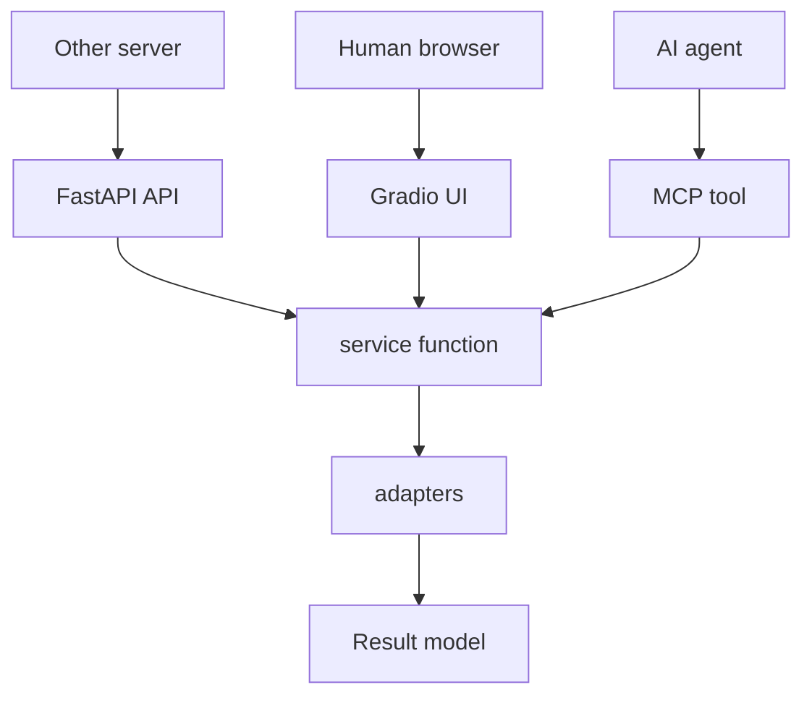

# architecture-note.md

新しいアプリを作るときの、最初の入れ物を決めるためのメモ。

これは完成した `architecture.md` ではない。アプリ固有の目的、画面、業務フロー、外部サービスがまだ固まっていない段階で、FastAPI + Gradio + MCP をどう置くかを決めるための下書きである。

## 目的

新しいアプリでは、最初から入口ごとに処理を分けない。

FastAPI、Gradio、MCP はそれぞれ別の利用者に向けた入口だが、処理本体は同じ service 層に寄せる。これにより、人間がブラウザで試す経路、他サーバーが HTTP で呼ぶ経路、AI agent が MCP で呼ぶ経路の仕様ずれを減らす。

## 前提

- アプリの内容は未定でよい。
- 最初に決めるのは、機能名ではなく入口と責務の分け方である。
- FastAPI は、他のサーバーや外部システムから呼ばれる統合口として置く。
- Gradio は、人間がブラウザで試すための UI として置く。
- MCP は、AI agent が同じ処理本体を安全に呼ぶための入口として置く。
- 処理本体は、HTTP endpoint、Gradio handler、MCP tool のどれにも直接書かない。

## 基本構造

```text
src/<app_name>/
  app.py          # FastAPI parent app
  api.py          # 他サーバー向け HTTP API
  ui.py           # Gradio UI
  mcp.py          # MCP tools/resources
  service.py      # アプリの正本処理
  models.py       # Pydantic models
  runtime.py      # env、設定、依存 client の組み立て
  adapters/       # 外部サービス、DB、ファイル、LLM などの差し替え口
```

必要になったら、`adapters/` の中を用途別に分ける。

```text
src/<app_name>/adapters/
  storage.py
  llm.py
  image.py
  audio.py
  external_api.py
```

## 責務分担

### FastAPI

FastAPI は、他サーバーから呼ばれるための安定した API 入口にする。

役割は、request を受け取り、Pydantic model で検証し、service 層を呼び、response を返すこと。外部システムが依存する可能性があるため、URL、request、response は UI よりも慎重に扱う。

FastAPI に置くもの:

- `/health`
- 他サーバー向けの JSON API
- file upload / download など HTTP として扱うべき入口
- Gradio mount
- MCP endpoint を同じプロセスに載せるための parent app

FastAPI に置かないもの:

- アプリ固有の長い処理本体
- provider ごとの細かい実装
- UI 表示の都合だけの状態管理

### Gradio

Gradio は、人間が試すための UI にする。

役割は、入力フォーム、ファイル upload、実行ボタン、結果確認を薄く提供すること。Gradio handler は service 層を呼ぶだけに近づける。

Gradio に置くもの:

- 手動検証しやすい入力欄
- 結果の見た目確認
- 失敗時の簡単な表示
- 開発中に触るための `/ui`

Gradio に置かないもの:

- 正本の business logic
- 他サーバーが依存する API contract
- MCP 専用の説明や agent 向け制約

### MCP

MCP は、AI agent がアプリの処理を呼ぶための入口にする。

役割は、agent に渡してよい操作だけを tool/resource として公開し、内部では service 層を呼ぶこと。人間用 UI や HTTP API と同じ処理本体を使うが、agent に見せる引数や説明は別に整える。

MCP に置くもの:

- agent が使う tool
- 必要なら resource
- tool 入力の説明
- agent に返す結果の整形

MCP に置かないもの:

- UI のためだけの表示処理
- HTTP request/response に依存した処理
- 長大な provider 実装

### service 層

service 層は、アプリの正本処理を置く場所にする。

FastAPI、Gradio、MCP はすべて service 層を呼ぶ。入口ごとの差は、入力変換と出力整形に閉じ込める。

service 層に置くもの:

- アプリの主要 use case
- 入力から出力までの処理順序
- adapter の呼び出し
- 成功/失敗の扱い

service 層に置かないもの:

- FastAPI の `Request` や `UploadFile` に強く依存する処理
- Gradio component そのもの
- MCP SDK 固有の object

## 呼び出しの形

入口は分けるが、最後は同じ関数へ寄せる。



最初の service function は、アプリの中心動詞を1つ選んで作る。

```python
def run_main_use_case(input: MainInput) -> MainResult:
    ...
```

アプリ固有の名前が決まったら、曖昧な `run_main_use_case` から置き換える。

例:

- `generate_manga()`
- `process_audio_turn()`
- `summarize_document()`
- `create_report()`

## models.py の考え方

入口ごとの型を増やしすぎない。

最初は、service 層の入力と出力を正本にする。

```python
class MainInput(BaseModel):
    ...


class MainResult(BaseModel):
    ...
```

FastAPI、Gradio、MCP で必要な形が違う場合は、入口層で変換する。

```text
FastAPI request -> MainInput -> service -> MainResult -> FastAPI response
Gradio values   -> MainInput -> service -> MainResult -> Gradio display
MCP arguments   -> MainInput -> service -> MainResult -> MCP result
```

## runtime.py の考え方

外部 provider、API key、保存先、model 名などは `runtime.py` に集める。

入口層や service 層が `os.environ` を直接読みすぎると、テストや差し替えが難しくなる。最初は小さくても、設定の組み立て場所を分けておく。

```text
runtime.py
  load_settings()
  build_runtime()
  get_storage()
  get_llm_client()
```

## adapters の考え方

外部サービスやファイルシステムは adapter に逃がす。

最初から本物の provider に繋がなくてよい。stub adapter で成功パターンを作り、FastAPI、Gradio、MCP の結線が動くことを先に確認する。

```text
service.py
  正本処理

adapters/*.py
  外部サービス、保存、変換、生成
```

stub で先に固定するもの:

- 入力を受け取れること
- service function が呼ばれること
- 期待する result model が返ること
- FastAPI、Gradio、MCP から同じ結果が見えること

あとから差し替えるもの:

- LLM provider
- 画像生成 provider
- STT / TTS provider
- DB
- object storage
- 認証

## 最初に作る endpoint

最初は、機能を増やすよりも全入口が同じ service を呼ぶことを確認する。

```text
GET  /health
POST /api/run
GET  /ui
MCP  run_main_use_case
```

`POST /api/run` は、他サーバーから呼ばれる前提で request/response を安定させる。

`/ui` は、開発者や利用者が手で動かすための確認口にする。

MCP tool は、AI agent が同じ use case を呼ぶための口にする。

## 最小完成条件

- FastAPI が起動する。
- `/health` が返る。
- `/api/run` が service 層を呼ぶ。
- `/ui` から同じ service 層を呼べる。
- MCP tool から同じ service 層を呼べる。
- service 層の入出力は Pydantic model で表現されている。
- 外部 provider が未確定でも stub で成功結果を返せる。
- 入口層にアプリの正本処理が散らばっていない。

## 避けること

- `app.py` にすべてを書く。
- Gradio handler に正本処理を書く。
- MCP module を巨大化させる。
- FastAPI の request model と service model を混ぜすぎる。
- provider 実装を service 層へ直接埋め込む。
- 最初から外部 API、認証、保存方式を全部決めようとする。
- 入口ごとに似た処理を重複実装する。

## アプリへ持ち込むときに埋める欄

```text
アプリ名:
主な利用者:
FastAPI を呼ぶ外部サーバー:
人間が Gradio で試す操作:
AI agent が MCP で呼ぶ操作:
最初の service function:
MainInput:
MainResult:
最初は stub にする adapter:
あとで本物に差し替える adapter:
```

## 判断が必要になる点

### 認証

他サーバーから FastAPI を呼ぶなら、いつか認証が必要になる。

ただし、最初の骨格作成では未確定でよい。`/api/*` に認証を足せる構造だけ意識しておく。

### 保存先

ファイルや生成物を扱うなら、ローカル保存、DB、object storage のどれかを選ぶ必要がある。

最初は local adapter でよい。あとから storage adapter を差し替える。

### 非同期処理

処理が長いアプリでは、HTTP request 中に完了させるか、job として受け付けるかを決める必要がある。

最初は同期処理でよい。時間がかかることが分かった段階で job model を足す。

## 下書きから正式 docs へ移す条件

このメモを各アプリの `docs/architecture-note.md` または `docs/architecture.md` に移すときは、次が埋まってからでよい。

- アプリ名
- 中心 use case
- FastAPI を呼ぶ相手
- Gradio で確認したい操作
- MCP で agent に任せたい操作
- service function 名
- 最初に stub にする adapter

正式な `architecture.md` にするのは、アプリ固有の制約と運用上の判断が入ってからでよい。
