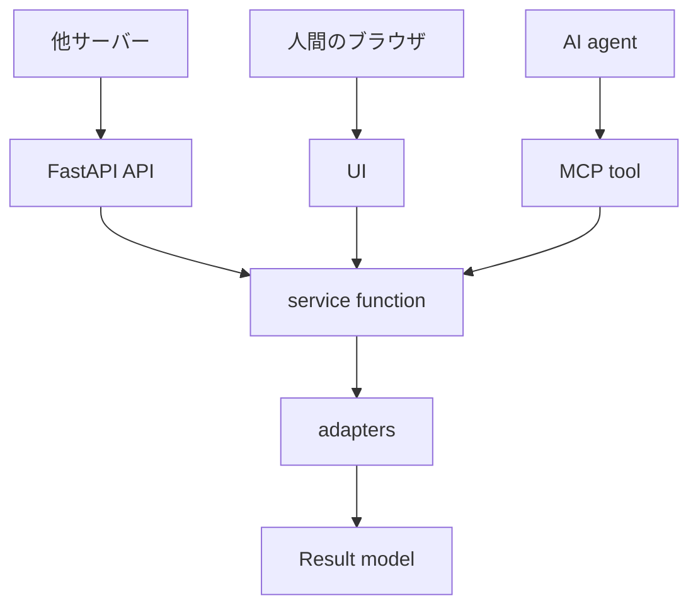

# new-app-template.md

新しいアプリを作るときの、最初の入れ物を決めるためのメモ。
（2026-07-13 audience-finder リファクタの教訓を反映）

完成した `architecture.md` ではない。アプリの内容が未定の段階で、FastAPI + UI + MCP を
どう置くかを決める下書き。最初に決めるのは機能名ではなく**入口と責務の分け方**である。

## 目的

入口ごとに処理を分けない。FastAPI（他サーバー向け）・UI（人間向け）・MCP（AI agent向け）は
別の利用者に向けた入口だが、処理本体は同じ service 層に寄せ、経路ごとの仕様ずれを防ぐ。
処理本体を HTTP endpoint・UI handler・MCP tool のどれにも直接書かない。

## 基本構造

```text
pyproject.toml    # hatchling + src layout。pip install -e ".[dev]"（PYTHONPATH小細工をしない）
src/<app_name>/
  main.py         # create_app(settings) ファクトリ（uvicorn の起動ターゲット）
  api.py          # 他サーバー向け HTTP API
  ui.py           # 人間向けUI（検証だけなら Gradio、育てる製品UIなら Jinja2 templates/）
  mcp.py          # create_mcp(service)（MCP tools/resources）
  service.py      # アプリの正本処理
  models.py       # Pydantic models
  config.py       # Settings（pydantic-settings、env prefix で上書き可）
  dependencies.py # DI（ServiceDep = Annotated[Service, Depends(...)]、404共通化）
  presentation/   # 表示用の純関数（見た目の選択ロジック。ルートに溜めない）
  adapters/       # 外部サービス、DB、ファイル、LLM などの差し替え口（用途別に分割可）
```

## 結線の作法（最重要）

入口と service を「どう繋ぐか」を最初に固定する。ここを曖昧にすると後で全面改修になる
（audience-finder は当初グローバル注入で作り、後日 Stage 0〜9 のリファクタが必要になった）。

- **create_app(settings) ファクトリ**に生成・結線を集める。service/settings は `app.state` に置き、
  ルートは `Annotated[Service, Depends(get_service)]`（ServiceDep）で受け取る。
- **モジュールレベルでインスタンスを作らない。** import しただけで実データに繋がる app は、
  テストが実データを汚染する事故のもと。テストは `create_app(Settings(data_dir=tmp))` で差し替える。
- **アンチパターン（禁止）**: `_service = None` ＋ `init(service)` のグローバル注入。
  テスト差し替え不能・import順依存・循環importの温床。

```python
def create_app(settings: Settings | None = None) -> FastAPI:
    settings = settings or Settings()
    service = Service(...)
    app = FastAPI(...)
    app.state.settings = settings
    app.state.service = service
    return app

app = create_app()  # uvicorn ターゲット用に末尾で1回だけ
```

## 責務分担

**FastAPI** — 他サーバーから呼ばれる安定した統合口。request を Pydantic で検証し service を呼ぶ。
`/health`・JSON API・file入出力・UIとMCPを載せる parent app を置く。
長い処理本体・provider実装・UI都合の状態管理は置かない。URL/request/response はUIより慎重に扱う。

**UI（Gradio または Jinja2）** — 目的で選ぶ：**動作検証だけなら Gradio、育てる製品UIなら Jinja2**。
handler は service を呼ぶだけに近づけ、表示用の選択ロジックは `presentation/` の純関数へ隔離する
（audience-finder では web ルートに表示ロジックが溜まり480行化した）。
正本ロジック・他サーバー依存のAPI契約は置かない。

**MCP** — agent に渡してよい操作だけを tool/resource として公開し、内部で service を呼ぶ。
UI用の表示処理・HTTP依存の処理・長大な provider 実装は置かない。

MCP 結線の罠3つ（実際に踏んだもの）:

1. **lifespan 配線が必須**。mount だけでは不完全。`FastAPI(lifespan=mcp_app.lifespan)` で配線する。
2. **`http_app(path="/")` を指定**。既定のまま `/mcp` に mount すると実体が `/mcp/mcp` になり Not Found。
3. **ツール内で FastAPI の Depends は効かない**。`create_mcp(service)` ファクトリのクロージャとして
   ツールを定義し、service を閉じ込める（グローバル変数を使わない）。

**service 層** — アプリの正本処理。主要 use case・処理順序・adapter 呼び出し・成功/失敗の扱いを置く。
FastAPI の `Request`/`UploadFile`、UI コンポーネント、MCP SDK 固有 object に依存しない。

## 呼び出しの形



最初の service function は中心動詞を1つ選んで作り（例: `generate_manga()`）、
固有名が決まるまでは `run_main_use_case(input: MainInput) -> MainResult` でよい。

## models.py の考え方

入口ごとの型を増やしすぎない。service 層の入出力（MainInput / MainResult）を正本にし、
入口ごとに必要な形が違えば入口層で変換する。

```text
FastAPI request / UI values / MCP arguments -> MainInput -> service -> MainResult -> 各入口の応答
```

## config.py の考え方

外部 provider・API key・保存先・model 名は `config.py` の Settings に集める。
手作りの load_settings() ではなく **pydantic-settings** を使う。

```python
class Settings(BaseSettings):
    model_config = SettingsConfigDict(env_prefix="APP_")
    data_dir: Path = ...   # 既定値はリポジトリ相対
```

既定値で開発が動き、env（`APP_*`）で上書き。入口層や service が `os.environ` を直接読まない。

## adapters の考え方

外部サービスやファイルシステムは adapter に逃がす。最初は本物に繋がず **stub** で成功パターンを作り、
全入口の結線が動くことを先に確認する。あとから差し替えるもの：LLM／画像生成／STT・TTS／DB／
object storage／認証。

stub の親戚として「**人間経由アダプタ**」も使える：アプリはプロンプトを表示するだけにして、
人間がAIに貼り、結果を貼り戻す。API統合（コスト・鍵管理）を先送りしたまま価値を検証できる
（audience-finder の「想像の一日」生成はこの方式で成立した）。

## 最初に作る endpoint

機能を増やすより、全入口が同じ service を呼ぶことを先に確認する。

```text
GET  /health
POST /api/run   # 他サーバー前提で request/response を安定させる
GET  /ui        # 人間の確認口
MCP  run_main_use_case
```

## 最小完成条件

- `pip install -e ".[dev]"` で入り、FastAPI が起動する。
- `/health` が返り、`/api/run`・`/ui`・MCP tool が同じ service 層を呼ぶ。
- service 層の入出力は Pydantic model で表現されている。
- 外部 provider が未確定でも stub で成功結果を返せる。
- `create_app(Settings(data_dir=tmp))` ＋ TestClient でルート層テストが書ける。
  MCP は in-memory Client で往復確認できる。
- 入口層にアプリの正本処理が散らばっていない。

## 避けること

- `main.py` にすべてを書く。
- **モジュールレベルでインスタンスを生成する**（import即・実データ直結の app）。
- **グローバル変数＋init() で service を注入する**（Depends を使う）。
- UI handler に正本処理を書く。ルート関数に表示ロジックを溜める（presentation/ へ）。
- MCP module を巨大化させる。provider 実装を service 層へ直接埋め込む。
- 最初から外部 API・認証・保存方式を全部決めようとする。入口ごとに似た処理を重複実装する。

## アプリへ持ち込むときに埋める欄

```text
アプリ名: / 主な利用者: / FastAPI を呼ぶ外部サーバー: / 人間がUIで試す操作:
AI agent が MCP で呼ぶ操作: / 最初の service function: / MainInput: / MainResult:
最初は stub にする adapter: / あとで本物に差し替える adapter:
```

## 判断が必要になる点（最初は未確定でよい）

- **認証** — `/api/*` に後から足せる構造だけ意識しておく。
- **保存先** — 最初は local adapter。あとから storage adapter を差し替える。
- **非同期処理** — 最初は同期。時間がかかると分かってから job model を足す。

## 下書きから正式 docs へ移す条件

アプリ名・中心 use case・呼ぶ相手・UIで確認したい操作・MCPで任せたい操作・service function 名・
最初に stub にする adapter が埋まってから。正式 docs は **2ファイル・各100行以内**に分けると読みやすい：

- `docs/architecture.md` — 責務分担（レイヤ図・モジュール別責務表・責務の原則）
- `docs/functional-design.md` — 機能設計（主要フロー・ER図・永続化・状態遷移）

この雛形自体は汎用のまま残し、アプリ固有の内容を書き込まない。
