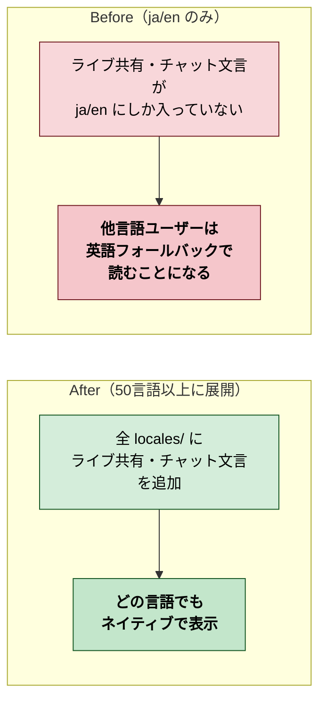

# 2026年4月12日 ライブ共有・チャット関連の文言を全言語に展開

> 状態：① Journey
> 次のゲート：（ユーザー）Journey 確認・承認 →「Gherkin」と指示

---

## 1) Journey（どこへ行くか）

- **深層的目的**：どの言語で使っても迷わないようにする
- **やらないこと**：新機能追加／既存文言の見直し（今回追加分のみ対象）

### 対象キー（3タスク分の合計）

| タスク | 追加キー数 |
|---|---|
| remote-pair-view（ライブ共有） | 12 |
| live-output-share（出力共有） | 0（追加キーなし） |
| live-chat（チャット） | 9 |
| **合計** | **21キー** |

---

## 2) Gherkin（完了条件）

<!-- フェーズ2で記入 -->

---

## 3) Design（どうやるか）

<!-- フェーズ3で記入 -->

---

## 4) Tasklist

<!-- フェーズ4で記入 -->

---

## 5) Discussion（記録・反省）

<!-- フェーズ5で記入 -->
