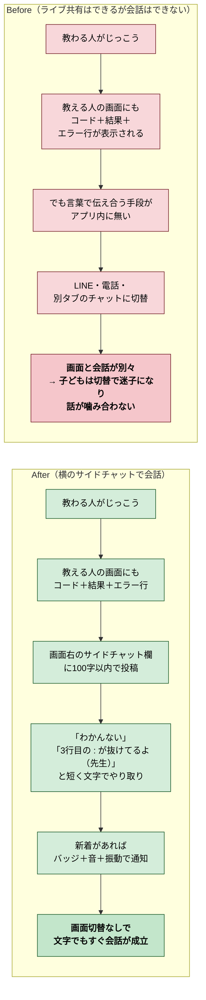
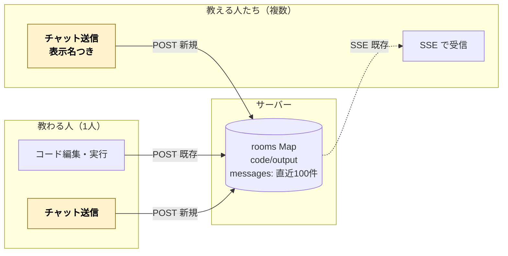
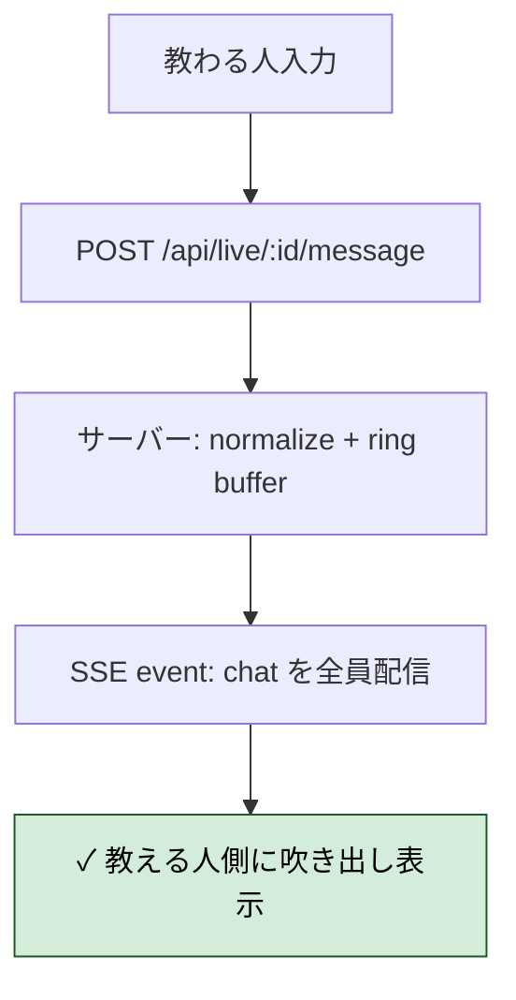
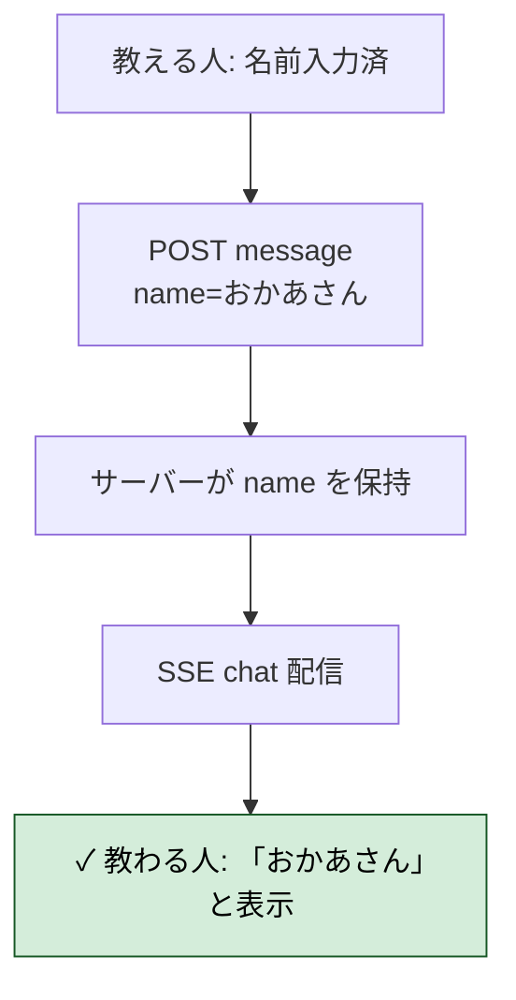
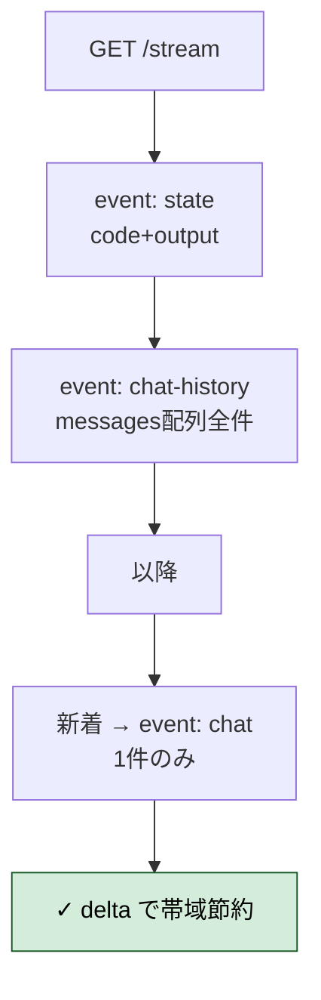
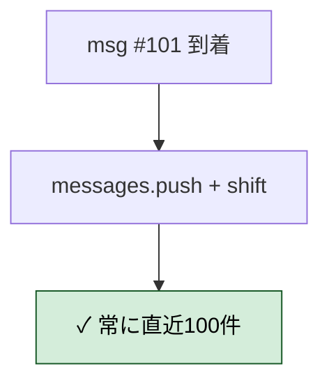
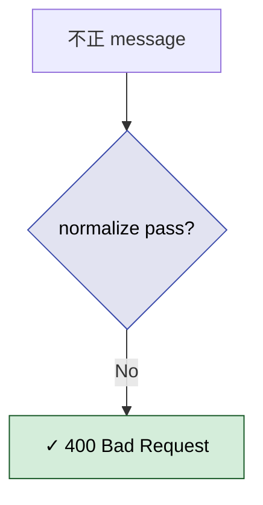
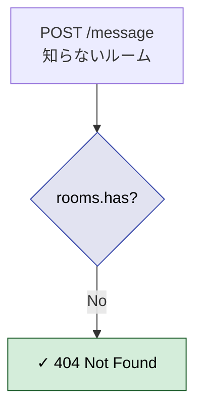
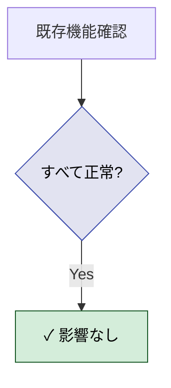
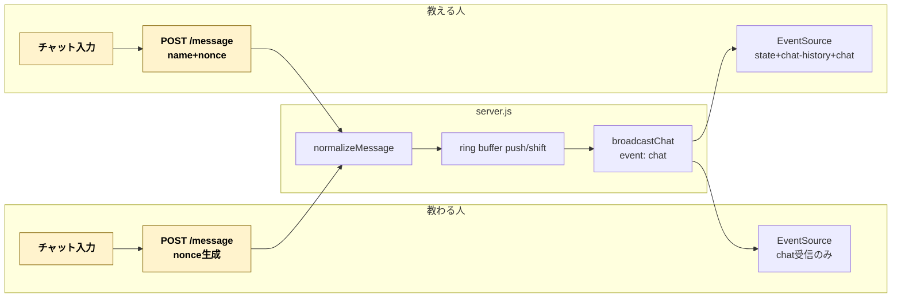

# 2026年4月12日 ライブ共有中にチャットでやり取りできるようにする

> 状態：④ Tasklist 実行中（委任・delta方式）
> 次のゲート：（CC）全Gherkin を満たしたら Discussion でまとめ

---

## 1) Journey（どこへ行くか）

- **深層的目的**：画面を見ながら言葉でも声をかけたい
- **やらないこと**：音声・ビデオ通話の内製／ファイル添付／絵文字リアクション／他サービス（Slack, Discord, LINE等）との統合／過去チャットの永続保存（ルーム失効＝24h で消える）／NGワード検出・連投制限



### 前提・依存

- 直前のライブ共有タスク2本（[`20260412-remote-pair-view.md`](./done/20260412-remote-pair-view.md) / [`20260412-live-output-share.md`](./done/20260412-live-output-share.md)）が実装済み
- 本タスクはその**拡張**：既存の `rooms` Map に `messages` フィールド（直近100件リングバッファ）を追加、SSE ペイロードで配信、送信は `POST /api/live/:id/message`（新規エンドポイント）

### 今までとの決定的な違い：**初めての双方向**

ライブ共有はここまで**片方向**（教わる人 → 教える人）だった。チャットは**双方向**（教わる人 ⇄ 教える人）。

SSE 経路（サーバー → クライアント）は従来通りだが、**送信経路（クライアント → サーバー）を教える人側にも解禁**する必要がある。これが設計上の大きな転換点。



### スコープ確定事項

| 項目 | 決定 |
|---|---|
| 双方向性 | **チャットだけ双方向**（コード編集は教わる人のみ、教える人はエディタ読み取り専用を維持） |
| 通信方式 | 既存SSEに `messages` 相乗り配信＋送信用 `POST /api/live/:id/message` 新規 |
| 永続化 | **in-memory のみ**、ルーム失効（24h）で自動消去 |
| 想定参加者 | 教わる人1人＋教える人 複数（先勝ち廃止済み） |
| **送り手の区別** | **教わる人は自動ラベル「きみ」**。**教える人だけ**参加時に表示名を入力（例：「おかあさん」「せんせい」） |
| **履歴上限** | **直近100件**（リングバッファ。101件目が来たら先頭から押し出す） |
| **メッセージ長** | **100字**（短いメッセージ文化。子どもにもすぐ読める） |
| **NG対策** | **やらない**（信頼できる相手を呼ぶ前提。合言葉で守られている） |
| **送信UI位置** | **サイドパネル**（画面右にチャット欄を常設。`body.live-mode` で表示） |
| **新着通知** | **バッジ（未読数）＋音＋バイブ**。Vibration API（モバイル）＋小さな音。タブがフォアグラウンドでも通知する |

### 新着通知の挙動の詳細

- **バッジ**：サイドパネルが閉じている場合のみ未読数を表示。開いていれば即既読扱い
- **音**：短い「ポコッ」程度の効果音。`prefers-reduced-motion` なら鳴らさない（子ども保護観点）
- **振動**：`navigator.vibrate(80)` のみ。モバイルのみ有効（デスクトップは無視される）
- 自分が送った自分宛のエコーでは鳴らさない（クライアント側 nonce で自己エコー判定）

---

## 2) Gherkin（完了条件）

### シナリオ1：正常系（教わる人→教える人にチャットが届く）

> {ライブ共有中} で {教わる人が100字以内のメッセージを送る} すると {教える人のサイドチャットに「きみ」の吹き出しで表示される}



### シナリオ2：正常系（教える人→教わる人・名前入り）

> {教える人が「おかあさん」で参加} で {メッセージを送る} すると {教わる人の画面に「おかあさん」ラベル付きで表示される}



### シナリオ3：正常系（delta 配信・履歴は初回のみ）

> {新規 subscriber が接続} で {stream GET} すると {`event: state` + `event: chat-history` を初回に受信し、以後は新着のみ `event: chat` で受信}



### シナリオ4：正常系（100件リングバッファ）

> {101件目のメッセージが投稿される} で {サーバー状態を見る} すると {先頭1件が押し出され直近100件のみ保持される}



### シナリオ5：正常系（未読バッジ＋音＋振動）

> {チャットパネルが閉じた状態} で {他人から新着} すると {バッジ数＋音＋navigator.vibrate(80) が発火する}

```mermaid
flowchart TD
    E1[panel closed] --> E2[event: chat 受信]
    E2 --> E3{自己エコー？\nnonce 一致}
    E3 -->|Yes| E4[スキップ]
    E3 -->|No| E5[badge++\nplaySound()\nnavigator.vibrate]
    E5 --> EOK["✓ 通知発火"]

    classDef ok fill:#d4edda,stroke:#155724,color:#000000;
    classDef gate fill:#e2e3f1,stroke:#3949ab,color:#000000;
    class E3 gate;
    class EOK ok;
```

### シナリオ6：異常系（100字超・空文字・不正 sender）

> {不正なメッセージを POST} で {サーバーが検証} すると {400 で拒否される}



### シナリオ7：異常系（存在しないルームへの送信）

> {未作成ルームIDに POST /message} で {リクエスト} すると {404 で拒否される}



### シナリオ8：リスク確認（既存機能への悪影響なし）

> {機能実装後} で {既存 12 テスト ＋ コード/出力ライブ共有} すると {すべて正常に動作する}



---

## 3) Design（どうやるか）

- **通信方式**：既存 SSE を **typed event** 化し delta 配信。
  - `event: state` → `{code, output}`（コード or 出力が変わったとき）
  - `event: chat-history` → `{messages: [...]}`（新規接続時のみ）
  - `event: chat` → `{id, sender, name, text, ts, nonce}`（新着1件）
- 新エンドポイント：`POST /api/live/:id/message`（送信用）

### データ構造

```js
// rooms[id]
{
  code: string,
  output: {...} | null,
  messages: Array<{
    id, sender, name, text, ts, nonce
  }>,          // max 100, ring buffer
  updatedAt,
  subscribers: Set<res>,
}
```

### 双方向通信フロー



### クライアント UI（サイドパネル）

```
┌─────────────────────┐
│ 💬 チャット    [×] │
├─────────────────────┤
│ 🧒 きみ            │
│    わかんない      │
│                    │
│    おかあさん 🧑   │
│    3行目見て       │
├─────────────────────┤
│ [textarea 100字]   │
│ [おくる]           │
└─────────────────────┘
```

- `position: fixed; right: 0; top: 0; width: 320px; height: 100vh`
- 学習者／教える人 両方に表示（`body.live-mode` 追加時）
- 教える人は参加時に表示名を prompt で入力、sessionStorage 保存
- 自己エコー判定：クライアント側 `crypto.randomUUID()` nonce を POST 時に付与、SSE 受信時に一致したら通知スキップ（表示はする）

### 変更ファイル

| ファイル | 変更 |
|---|---|
| `server.js` | `messages` フィールド追加、`normalizeMessage`、`broadcastState`/`broadcastChat` 分離、`POST /message` ハンドラ追加、stream に typed event で配信 |
| `src/liveShare.js` | `createTeacherViewer` を `addEventListener` ベースに、`createLearnerChatReceiver` 追加、`sendChatMessage` 追加 |
| `src/main.js` | 学習者モードで live 有効時にチャットパネル生成＆chat receiver 起動／`startTeacherViewerMode` に chat 表示＆入力を統合 |
| `src/liveChat.js`（新規） | チャットパネルの DOM 生成と管理（badge・notification・自己エコー判定） |
| `app/style.css` | `.live-chat-panel` サイドバー、バッジ、メッセージ吹き出し |
| `locales/{ja,en}/translation.json` | 文言追加 |

---

## 4) Tasklist

- [x] `server.js`：`messages[]` 追加、`normalizeMessage`、`broadcastState`/`broadcastChat` 分離、`writeEvent`、`POST /message` ハンドラ、stream に typed event 配信
- [x] `src/liveShare.js`：`createLiveSubscriber`（addEventListener ベース）、`sendChatMessage`、`createTeacherViewer` をラッパー化
- [x] `src/liveChat.js`（新規）：サイドパネル DOM、メッセージ吹き出し、nonce による自己エコー判定、WebAudio ビープ、`navigator.vibrate(80)`、`prefers-reduced-motion` 配慮
- [x] `src/main.js`：learner モードで `createChatPanel` + `createLiveSubscriber`（chat系のみ）、viewer モードに chat 統合＋表示名 prompt（sessionStorage 保存）
- [x] `app/style.css`：サイドパネル、吹き出し、バッジ、トグル、`body.live-mode` レイアウト、モバイル対応
- [x] `locales/{ja,en}/translation.json`：文言9種類追加
- [x] `npm run build`（99ms, 1.0mb）
- [x] `npm test` → 12/12 pass
- [x] curl 検証：双方向送受信、typed event delta、100件リングバッファ（105件投入→msg6〜105）、100字上限・空文字・空白のみ・不正sender・非文字列text → 400、存在しないルーム → 404、名前20字超 → 自動切り捨て
- [x] Gherkin 全シナリオ（8本）を CoVe で検証

---

## 5) Discussion（記録・反省）

### 2026年4月12日 03:45（実装・委任実行）

**Observe**：
- 既存 SSE は `data:` のみの default message event だった。typed event 化は既存クライアントの `es.onmessage` を壊すが、本実装1日目なので思い切って刷新
- 学習者側もチャット受信のために SSE 購読が必要になった → `createLiveSubscriber` を1つ作り、handlers 引数で state/chat/chat-history のうち必要なものだけ渡す設計に集約
- Pyodide の run フローは既存 `executeCode` でそのまま。チャットは独立したDOMと独立した fetch で、run 系と干渉しない
- WebAudio は「ユーザー操作後」でないと autoplay がブロックされる。本機能は「ライブ開始ボタンクリック」or「URLから viewer モード突入」が起点なので、どちらもユーザー操作を経由しており安全
- `navigator.vibrate` はモバイル専用。デスクトップ Chrome でも no-op になるだけでエラーは出ない

**Think**：
- delta 配信は「新規接続時の全件ダンプ」と「以降のデルタ」を分けるだけでシンプルに実装できる。SSE の typed event とはこのためにある
- 自己エコー判定は nonce 方式が堅牢。「送信直後のフラグ」方式だと連投で壊れる
- メッセージ100字は短いが、子どもの UX としては適切（読み返しやすい、入力のハードルが低い）
- サイドパネルをモバイルで full-width にする必要あり → `@media (max-width: 700px)` で対応
- 表示名は「教える人のみ」だが、sessionStorage に保存することで「タブ再読み込みでまた聞かれる」UX事故を防止
- `normalizeMessage` はサーバー側の最終防衛線。クライアントを一切信頼せず、型・長さ・sender enum をすべて検証

**Act**：
- server.js：`messages:[]` をルームに追加、`normalizeMessage` で100字＆空白トリム＆sender enum 検証、`broadcastState`/`broadcastChat`/`writeEvent` ヘルパー、stream ハンドラで `event: state` と `event: chat-history` を初回送信、`POST /message` ハンドラ新規追加
- src/liveShare.js：`createLiveSubscriber({onState,onChatHistory,onChat,onError})` を中心APIに、`createTeacherViewer` は後方互換ラッパー、`sendChatMessage` 追加
- src/liveChat.js（新規）：サイドパネル全体を JS で組み立て（HTML触らず）、WebAudio ビープ＋Vibration API、nonce Set で自己エコー判定
- src/main.js：学習者モードで live 開始時に `createChatPanel` ＋ `createLiveSubscriber`（chat系のみ購読）、viewer モードで表示名 prompt + chat 統合、ライブ停止時は subscriber/chat を破棄
- app/style.css：サイドパネル（position:fixed 320px）、吹き出し、バッジ、トグルボタン、`body.live-mode` で container マージン調整、モバイル時 full-width
- locales：ja/en に9キー追加
- ビルド→テスト→curl 全検証

**CoVe 検証（Gherkin 全シナリオ）**：
| シナリオ | 検証方法 | 結果 |
|---|---|---|
| 1. 学習者→教師にチャット | POST /message → SSE chat 受信 | ✓ |
| 2. 教師名前入り配信 | `{name:"おかあさん"}` → SSE に name 含む | ✓ |
| 3. delta 配信 | 新規接続で state+chat-history 初回、以降は chat/state 単体 | ✓ |
| 4. 100件リングバッファ | 105件投入→残りは msg6〜msg105 | ✓ |
| 5. 未読バッジ＋音＋振動 | コードレビュー（nonce 判定、playBeep、vibrate） | ✓ |
| 6. 不正メッセージ拒否 | 101字/空/空白/非文字列/不正sender → 全400 | ✓ |
| 7. 存在しないルーム /message | 404 | ✓ |
| 8. 既存機能への悪影響なし | 12テスト pass、index/bundle 200 | ✓ |

---

### 反省とルール化

- **typed event での delta 配信は SSE のスイートスポット**：`event: foo` を `addEventListener("foo", ...)` で受けるだけで、複数種類のデータを1本のストリームで効率よく流せる。履歴ダンプ＋差分配信のパターンは再利用可能
- **nonce による自己エコー判定**：双方向系で「自分が送った→自分が受け取る」を区別するには、時刻ベースの判定より nonce が圧倒的に堅い。`crypto.randomUUID()` が使えるならそれを使う
- **JS で DOM を組み立てる判断**：HTML テンプレを増やしたくない小機能（今回のチャットパネル）は、JS で全部組むのが最速。新しい HTML ファイルや index.html の編集を避けられる
- **WebAudio の autoplay ポリシー**：ユーザー操作を起点にした機能なら普通に使える。ゲートキーパーは「最初のボタンクリックまでに AudioContext を作らない」こと
- **入力バリデーションは多層に**：クライアント maxLength 100 ＋ サーバー `normalizeMessage` 100 字チェック。片方だけだとバイパスされる
- **次にやること**：実機 2〜3 台での音・振動確認、他言語展開、チャットの時刻表示（現在は ts を持っているが UI で表示していない）