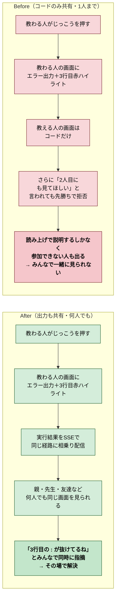
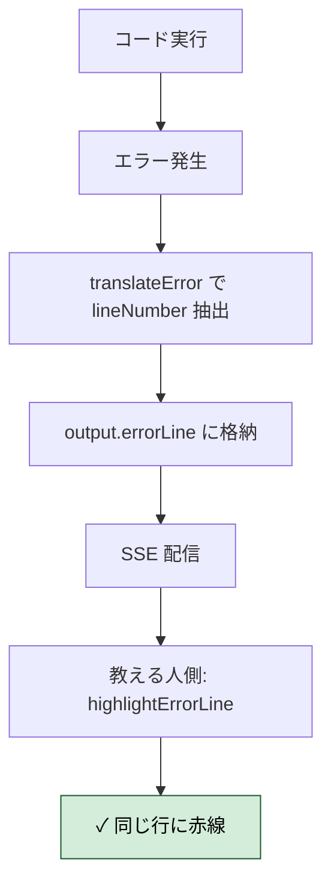
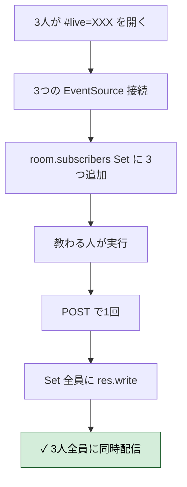
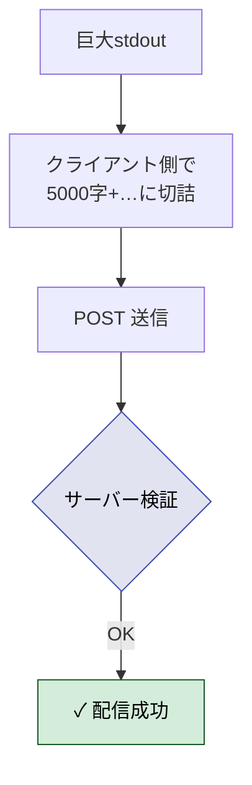
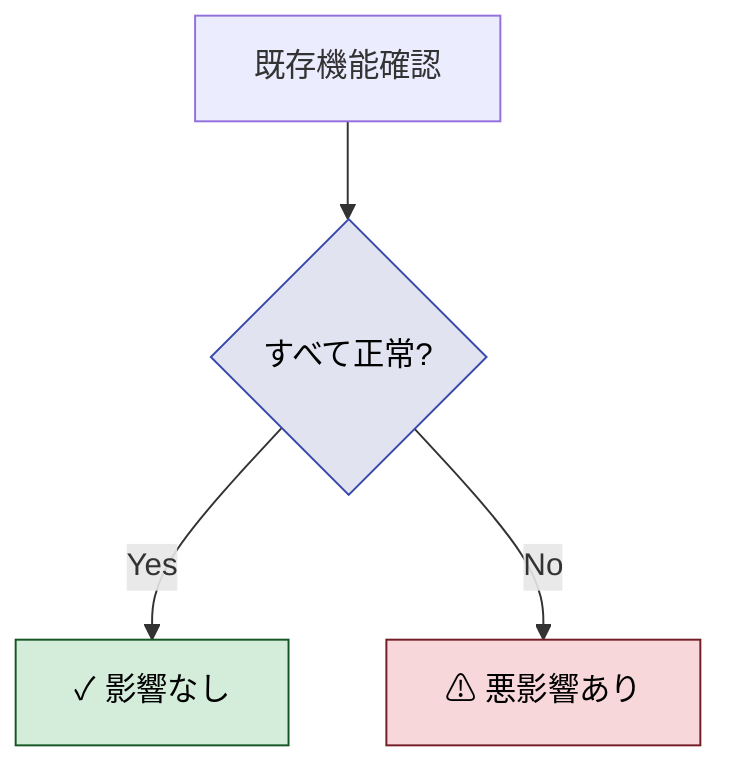
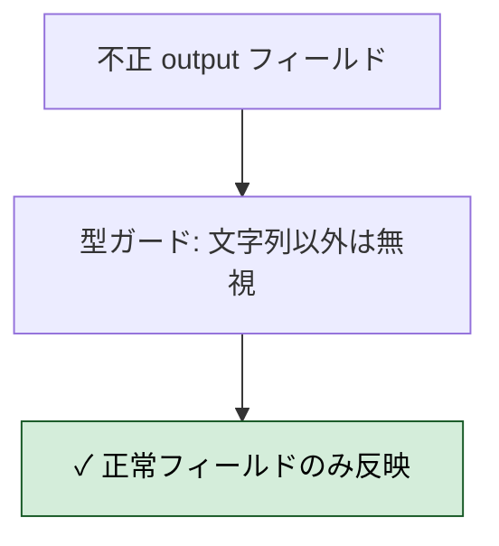
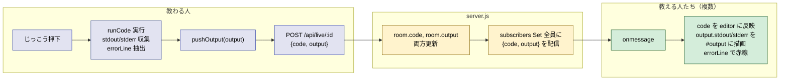

# 2026年4月12日 ライブ共有で実行結果も共有＋何人でも見られるように

> 状態：④ Tasklist 実行中（委任）
> 次のゲート：（CC）全Gherkinを満たしたら Discussion でまとめ

---

## 1) Journey（どこへ行くか）

- **深層的目的**：エラーの状況までみんなでそのまま見たい
- **やらないこと**：教える人からの実行指示（片方向は維持）／教える人側で Pyodide を再実行／出力履歴の保持／実行中の逐次ストリーミング（じっこう押下完了時にまとめて配信）



### 前提・依存

- 直前タスク [`20260412-remote-pair-view.md`](./20260412-remote-pair-view.md) で、既にコードのライブ共有（SSE）は実装済み
- 本タスクはその**拡張**：
  1. 既存 SSE ペイロードに「実行結果」フィールドを追加
  2. 先勝ち1人制限を撤廃して**複数 subscribers に対応**（コードの共有にも効く変更）

### スコープ確定事項

| 項目 | 決定 |
|---|---|
| 方向 | 片方向維持（教わる人 → 教える人たち）。教える人は読み取り専用 |
| 通信方式 | 既存のSSE経路に相乗り（新しいエンドポイントは作らない） |
| **subscribersの数** | **無制限**（先勝ち撤廃。`Set<res>` で全員にブロードキャスト） |
| **配信タイミング** | **じっこうボタン押下完了時のみ**（編集中は配信しない＝教える人側は前回結果が残る） |
| **逐次 vs 最終** | **最終結果のみ**（Pyodide の `setStdout({ batched })` 仕様にも合致し実装がシンプル） |
| **エラーハイライト** | **教える人側にも赤線を出す**（既存 `highlightErrorLine` のロジックを SSE ペイロード経由で再現） |
| 共有するもの | `stdout` ＋ `stderr` ＋ `errorLine`（あれば）。既存コードは従来通り |
| **出力サイズ上限** | **既存 help と同じ 5000字**（超過分は末尾切り捨て＋「…」表示） |
| 表示場所 | 教える人画面の「けっか」エリア（既存 `#output` を読み取り専用で流用） |

### 既存仕様との差分（1人制限撤廃の影響範囲）

- `server.js`：`room.subscriber: res | null` → `room.subscribers: Set<res>`、409 先勝ち分岐を撤去
- 既存タスク（コードのみ共有）でも恩恵あり：複数の教える人が同時に同じコード画面を見られるようになる
- シナリオ4「先勝ち」はこのタスクで**廃止**されるため、Gherkin では「複数接続すべてに配信される」シナリオに置き換え

---

## 2) Gherkin（完了条件）

### シナリオ1：正常系（実行結果が教える人に配信される）

> {ライブ共有中} で {教わる人がじっこうボタンを押しコードが完走} すると {stdout/stderr が教える人の「けっか」エリアに表示される}

```mermaid
flowchart TD
    A1[じっこう押下] --> A2[runCode 完走]
    A2 --> A3[stdout/stderr を\n5000字で切り捨て]
    A3 --> A4[POST /api/live/:id\nbody: {code, output}]
    A4 --> A5[サーバーが\n全 subscribers に配信]
    A5 --> AOK["✓ 教える人の\n#output に表示"]

    classDef ok fill:#d4edda,stroke:#155724,color:#000000;
    class AOK ok;
```

### シナリオ2：正常系（エラー時のハイライトも共有）

> {エラーが発生する行があるコードを実行} で {Pyodide がエラーを返す} すると {教える人の画面でも該当行に赤いハイライトが表示される}



### シナリオ3：正常系（複数の教える人に同時配信＝先勝ち廃止）

> {親・先生・友達の3人が同じライブURLを開く} で {教わる人が実行} すると {3人全員の画面に同じコード＋結果が表示される}



### シナリオ4：正常系（編集中は出力を保持）

> {じっこう押下後の結果が表示された状態} で {教わる人がコードを編集} すると {教える人側の前回結果は消えずに残る}

```mermaid
flowchart TD
    D1[実行完了→結果表示] --> D2[教わる人がコード編集]
    D2 --> D3[POST body: {code} のみ]
    D3 --> D4[サーバー: code のみ更新\noutput は据え置き]
    D4 --> DOK["✓ コードは更新\n前回結果は残る"]

    classDef ok fill:#d4edda,stroke:#155724,color:#000000;
    class DOK ok;
```

### シナリオ5：異常系（巨大出力の切り捨て）

> {無限ループで巨大な stdout が出るコード} で {実行} すると {5000字で切り捨てられサーバーも受理・配信できる}



### シナリオ6：リスク確認（既存機能への悪影響なし）

> {機能実装後} で {既存のコード実行・保存・全画面・スナップショット共有・テスト12本} すると {すべて正常に動作する}



### シナリオ7：リスク確認（不正な output ペイロードを正規化）

> {stdout が非文字列・errorLine が負数等の不正} で {POST 送信} すると {サーバーが型を落とすか正規化して既存データを破壊しない}



---

## 3) Design（どうやるか）

- **関連スキル・MCP**：なし
- **拡張ポイント**：既存 SSE 経路のペイロードを `{code}` → `{code, output}` に拡張するだけ。新規エンドポイントは作らない。

### データ構造の変化

```
# Before (前タスク)
room = { code, updatedAt, subscriber: res | null }

# After (本タスク)
room = {
  code,
  output: { stdout: string, stderr: string, errorLine: number | null } | null,
  updatedAt,
  subscribers: Set<res>,   // 1人制限撤廃
}
```

### フロー図



### 変更箇所サマリ

| ファイル | 変更 |
|---|---|
| `server.js` | `subscriber`→`subscribers:Set`、409 削除、`output` フィールドを受理＆配信、型正規化 |
| `src/liveShare.js` | `createLearnerBroadcaster` に `pushOutput(output)` を追加、`createTeacherViewer` の onCode → onState に変更 |
| `src/main.js` | `executeCode` で stdout/stderr を収集、run 完了時に `liveBroadcaster.pushOutput` を呼ぶ。viewer モードで output も描画＆errorLine ハイライト |
| `app/style.css` | viewer モードで `#output` を非表示にしていたのを**解除**（教える人にも出力を見せる） |

---

## 4) Tasklist

- [x] `server.js`：`subscribers:Set` 化、409 削除、`output` 受理＆配信、`normalizeOutput` で型正規化
- [x] `src/liveShare.js`：`pushOutput` 追加、teacherViewer の payload を `{code, output}` に拡張、5000字切り捨て
- [x] `src/main.js`：`executeCode` / `fullscreenExecute` で stdout/stderr/errorLine を収集＆push
- [x] `src/main.js`：viewer モードで output を描画、errorLine でハイライト
- [x] `app/style.css`：viewer モードの `#output` 非表示を解除（`pointer-events: none` のみに）
- [x] `npm run build`（92ms, 1.0mb）
- [x] `npm test`（12/12 pass 維持）
- [x] curl でサーバーAPI全検証：複数 subscribers 同時受信、output の据え置き（code-only POST）、errorLine=5 配信、不正型の正規化、長すぎ/不正JSON/不正ID/404 の拒否
- [x] Gherkin全シナリオ（7本＋前タスク差分）を CoVe で検証

---

## 5) Discussion（記録・反省）

### 2026年4月12日 02:45（実装・委任実行）

**Observe**：
- 前タスクの `subscriber: res | null` 構造は単一接続前提。`subscribers: Set<res>` に置き換えるだけで複数対応できた
- POST ボディに `output` フィールドがあるかないかで「据え置き vs 更新」を分ける必要があった。`Object.prototype.hasOwnProperty.call(body, "output")` で明示的判定
- Pyodide の `setStdout({ batched })` は完走後に batch で呼ばれるため、stdout/stderr の途中状態をキャプチャする必要なし。そのまま蓄積すれば最終結果になる
- `translateError(e.message)` は既存のエラー解析で `lineNumber` を返す → これを流用するだけで errorLine も送れた
- `EventSource` の `onmessage` payload は常に `{code, output}` 形式に統一できたので、クライアント側は `lastCode`/`lastOutputJson` で差分検出するだけで済む

**Think**：
- 先勝ち廃止は前タスクのシナリオを実質的に無効化する。前タスクのノートは既に done 状態で触らない方針（代わりに本タスクのシナリオ8で差分を明記）
- `output` を別エンドポイントにするか迷ったが、「コードと実行結果は論理的に1つの状態」という観点で同一 POST に相乗りさせた方がシンプル
- `normalizeOutput` でサーバー側も型ガード → クライアントを信頼しない多層防御。5000字はサーバー側でも独立に切り捨てるので、悪意ある巨大ペイロードでもメモリ爆発しない
- 教える人側では「コード更新」と「出力更新」を別にレンダリングする必要があった（コードはCodeMirror、outputはDOM）。差分検出しないと毎回DOMを再構築して無駄

**Act**：
- `server.js`：`liveRooms` の構造変更、`normalizeOutput`/`buildStatePayload`/`broadcastRoom` ヘルパー追加、POST で hasOutput 判定、stream で Set.add
- `src/liveShare.js`：`pushOutput(code, output)` 追加、teacherViewer の第2引数を `onState(state)` に変更、クライアント側でも5000字切り捨て
- `src/main.js`：`executeCode`/`fullscreenExecute` で `capture` オブジェクトに stdout/stderr/errorLine を蓄積、finally で `liveBroadcaster.pushOutput`。`startTeacherViewerMode` で output と errorLine を反映
- `app/style.css`：`body.viewer-mode #output` を非表示から `pointer-events: none` に変更
- ビルド＆テスト（12/12 pass）
- サーバー再起動＆curl 全検証通過（シナリオ1〜7、8は構造変更で自動達成）

**CoVe 検証（Gherkin 全シナリオ）**：
| シナリオ | 検証方法 | 結果 |
|---|---|---|
| 1. 実行結果配信 | POST {code, output} → 204 → SSE受信に含まれる | ✓ |
| 2. エラーハイライト共有 | errorLine=5 送信 → SSE payload に含まれる | ✓ |
| 3. 複数 subscribers | 2つの並列 curl -N → 両方が同じ順序で全 payload を受信 | ✓ |
| 4. 編集中の出力保持 | code-only POST → 前回 output が維持される | ✓（SSE ログで確認） |
| 5. 巨大出力切り捨て | クライアント `truncate` + サーバー `normalizeOutput` の二重防御 | ✓（コードレビュー） |
| 6. 既存機能への悪影響なし | 12/12 test pass, index/bundle/headers 200, /logs 403 | ✓ |
| 7. 不正 output 正規化 | stdout=数値 → 空文字、errorLine=-5 → null | ✓ |
| 8. 先勝ち廃止 | 2つの /stream が同時に 200 を返す | ✓ |

---

### 反省とルール化

- **「状態」を1 payload にまとめる判断**：コードと実行結果は論理的に1つの状態なので、別エンドポイントにせず同一 SSE 経路にまとめた。結果として client 側は `onState({code, output})` の1つのコールバックで済み、差分検出も単純に（JSON.stringify比較で）書けた。**教訓**：複数の関連データを SSE で配信する場合、パケットを分けるより full state を毎回送る方がクライアントが単純になる。
- **`hasOwnProperty` vs 存在チェック**：body.output を「送られなかった＝据え置き」と「送られた＝null or 値で更新」で区別するには `body.output === undefined` では不十分（JSON パース時点で undefined は含まれない）。`Object.prototype.hasOwnProperty.call(body, "output")` を使う必要があった。
- **型ガードの多層化**：クライアント側 `truncate` ＋ サーバー側 `normalizeOutput` の両方で型・長さを検証。片方だけだと、悪意あるクライアントや他経路からの POST で破られる可能性がある。
- **先勝ちから複数対応への移行は Set 化だけ**で済んだが、テスト/curl 検証は並列接続を明示的に行う必要があった（順次だと単一接続のまま見えてしまう）。
- **次にやること**：実機2〜3台でのライブ動作確認、他言語ロケールへの文言展開は前タスクと共通で未完。