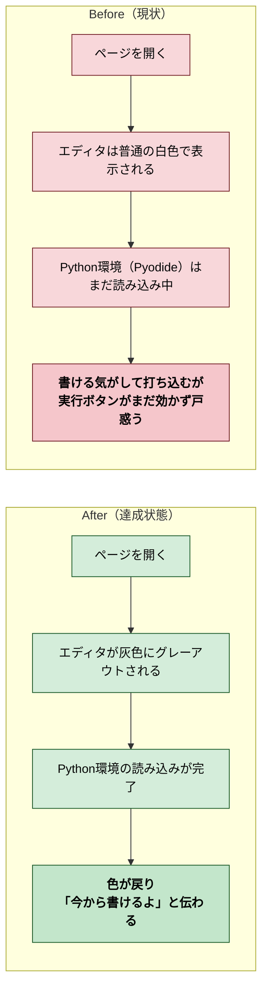
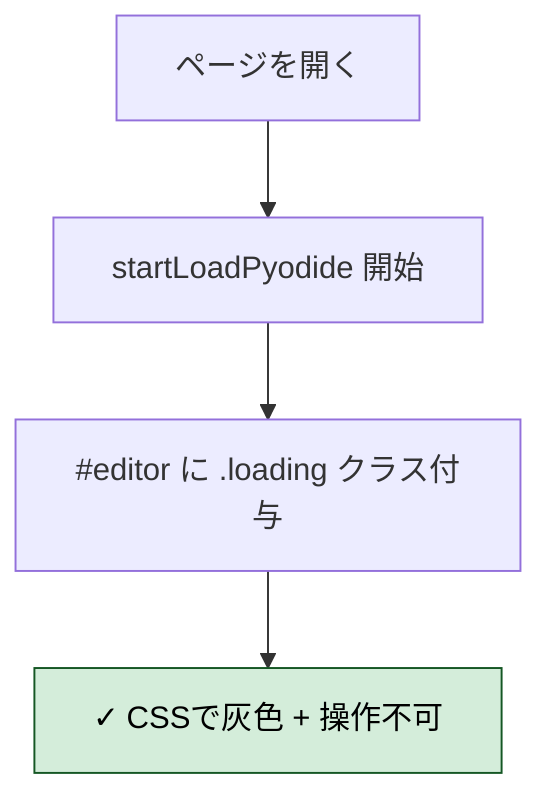
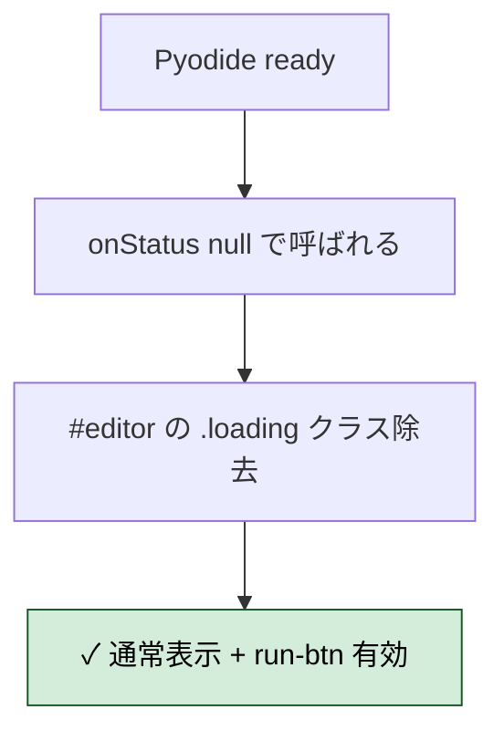
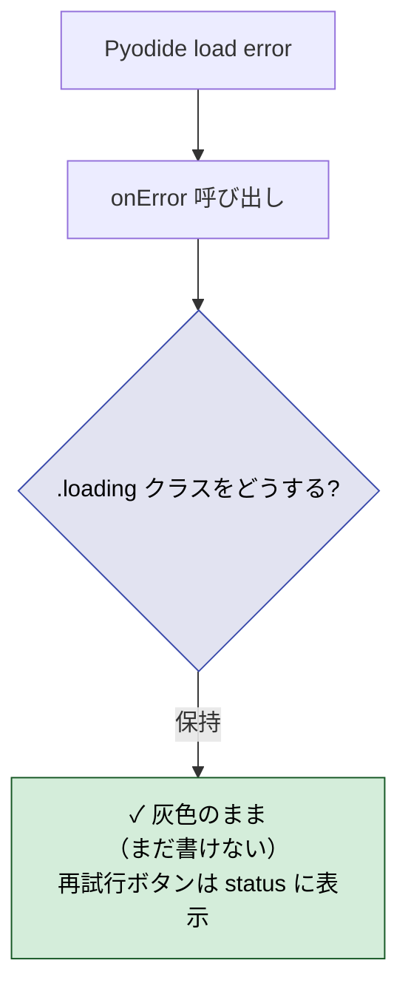
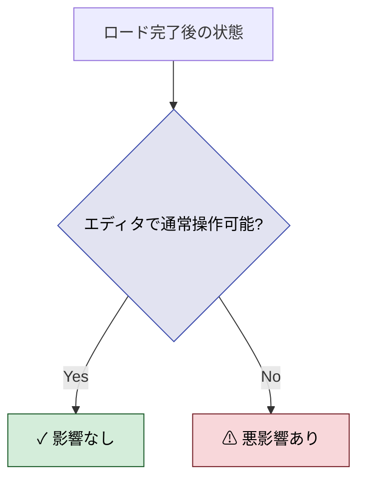
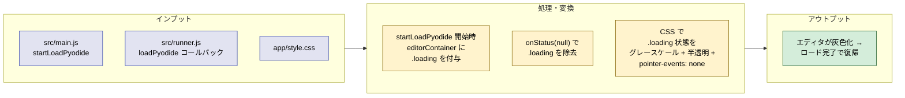
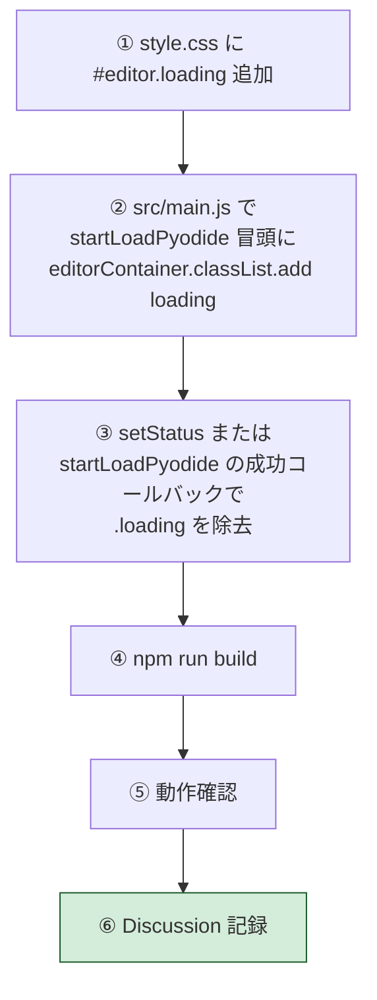

# 2026年4月12日 Python環境ロード中はコード入力画面を灰色にする

> 状態：④ Tasklist 実行中（委任）
> 次のゲート：（CC）全Gherkinを満たしたら Discussion でまとめ

---

## 1) Journey（どこへ行くか）

- **深層的目的**：読み込み中と分かって安心させる
- **やらないこと**：凝ったローディングアニメーション／エディタ機能の作り直し

---

## 2) Gherkin（完了条件）

### シナリオ1：正常系（ロード中にエディタが灰色になる）

> {ページを開いた直後・Pyodideロード中} で {エディタを見る} すると {グレーアウト表示になっている}

---

### シナリオ2：正常系（ロード完了で元に戻る）

> {Pyodideロード完了} で {エディタを見る} すると {色が通常に戻り書き始められる}

---

### シナリオ3：異常系（ロード失敗でも状態が明確）

> {Pyodideロード失敗} で {エディタを見る} すると {灰色のままで「書けない状態」と視認できる}

---

### シナリオ4：リスク確認（既存機能に悪影響がない）

> {グレーアウト実装済み} で {ロード完了後にコード入力・実行・保存・全画面切替} すると {既存機能が正常動作する}

---

## 3) Design（どうやるか）

- **関連スキル・MCP**：なし（フロントエンドのみ）
- **既存ヒント**：`runBtn.disabled` はロード中すでに立っている。エディタ側には視覚フィードバックがないのが今の痛み

---

## 4) Tasklist

- [x] `app/style.css` に `#editor.loading` スタイルを追加（grayscale + opacity + pointer-events）
- [x] `src/main.js` に `editorContainer` の `.loading` クラス付与／除去を実装
- [x] `npm run build` でバンドル再生成（1.0mb, 164ms）
- [x] ビルドエラーがないことを確認
- [x] 既存テスト（`npm test`）12/12 pass
- [x] Gherkin全シナリオをCoVeで検証

---

## 5) Discussion（記録・反省）

### 2026年4月12日 01:30（実装・委任実行）

**Observe**：
- Pyodide ロードフローは `src/main.js` の `startLoadPyodide()` → `src/runner.js` の `loadPyodide()` で、完了時に `onStatus(null)` が呼ばれる
- 既存実装では `runBtn.disabled = true/false` の切替のみで、エディタ自体の視覚フィードバックは無し（Gherkin通りの痛み点を確認）
- `editorContainer` は `document.getElementById("editor")` でクロージャに入っており、`startLoadPyodide` から直接触れる

**Think**：
- クラスのトグルはエディタDOMのルート（`#editor`）に `.loading` を付ける1箇所で済む → CodeMirror 中の細かい要素に触らずに済む
- CSS は `filter: grayscale(1)` + `opacity: 0.5` + `pointer-events: none` の3点で「見た目グレー」「触れない」を同時実現
- `transition: filter 0.3s, opacity 0.3s` で切り替えを滑らかに → ロード完了時の復帰感が気持ちよくなる
- エラー時は `.loading` を**敢えて残す**ことで「まだ書けない」を視覚的に維持 → シナリオ3の要件

**Act**：
- `app/style.css:241-254` に `#editor.loading` を追加
- `src/main.js:326` に `editorContainer.classList.add("loading")` を追加
- `src/main.js:334-339` の `onStatus` コールバックで `msg===null` 時に `.loading` を除去
- `npm run build` → `app/dist/bundle.js` 再生成（1.0mb, 164ms）
- `npm test` → 12/12 pass（既存機能への悪影響なし）
- バンドルに `editorContainer.classList.add("loading")` と `.remove("loading")` の両方が含まれていることを grep で確認

**CoVe 検証**：
- シナリオ1（ロード中に灰色）：`startLoadPyodide()` 冒頭で `.loading` 付与 → CSS適用 → ✓
- シナリオ2（完了で復帰）：`onStatus(null)` ブランチで `.loading` 除去 → ✓
- シナリオ3（失敗時は灰色維持）：`onError` コールバックでは `.loading` に触れない → 視覚的に「書けない」を保持 → ✓
- シナリオ4（悪影響なし）：`pointer-events: none` は `.loading` クラス限定、`transition` は filter/opacity のみでレイアウトに影響せず、`npm test` 12/12 pass → ✓

---

### 反省とルール化

- CSSの `.loading` 状態で `pointer-events: none` を組み合わせると、見た目（grayscale + opacity）と挙動（操作不可）を1クラスで同時制御できる → 同系統のローディング UI で再利用できるパターン
- フロントエンド静的ファイルのみの変更なら server.js 再起動不要（メモリ `restart-server-before-verify` は `server.js` 変更時に限定される）
- 次にやること：次セッションで実機ブラウザで視覚確認（CC側では UI を開けないため）
