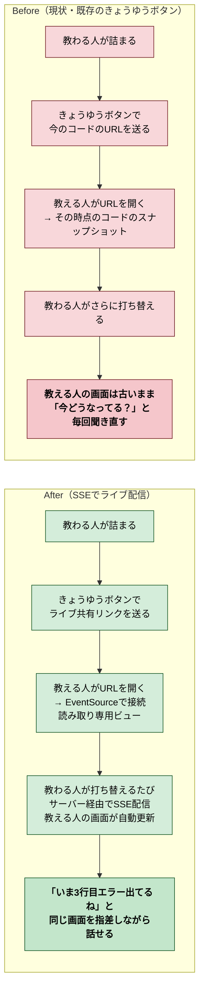
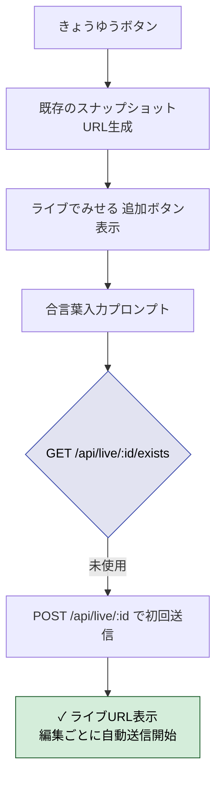
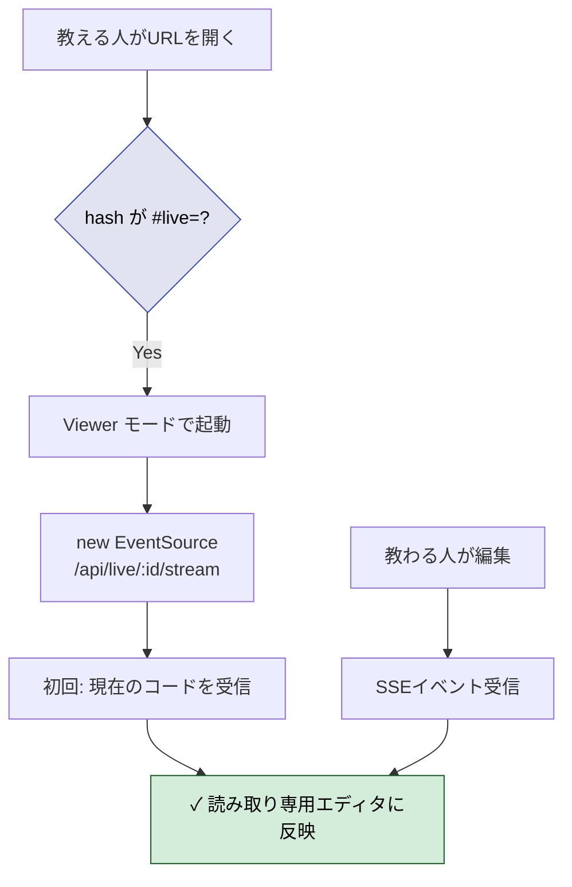
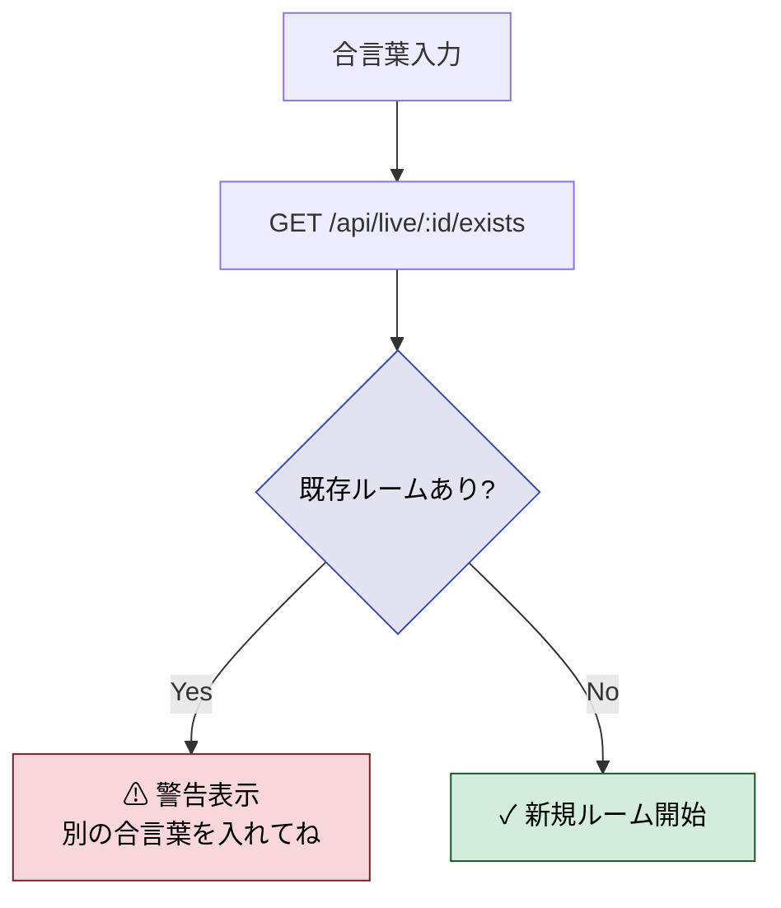
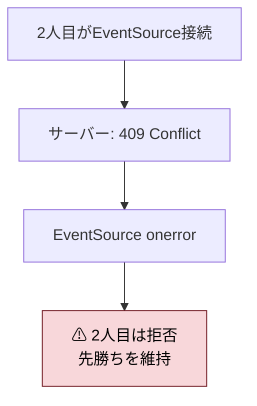
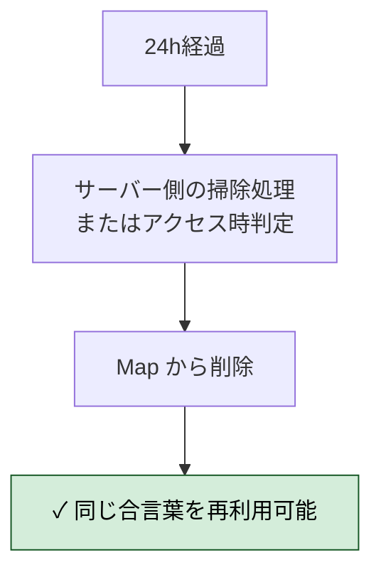
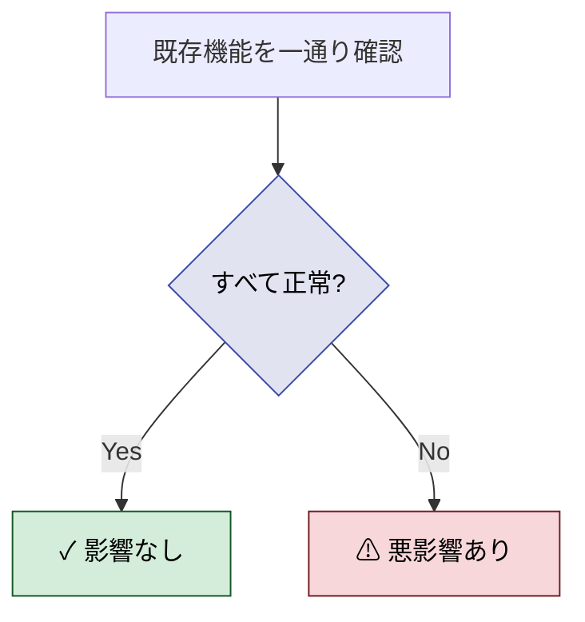
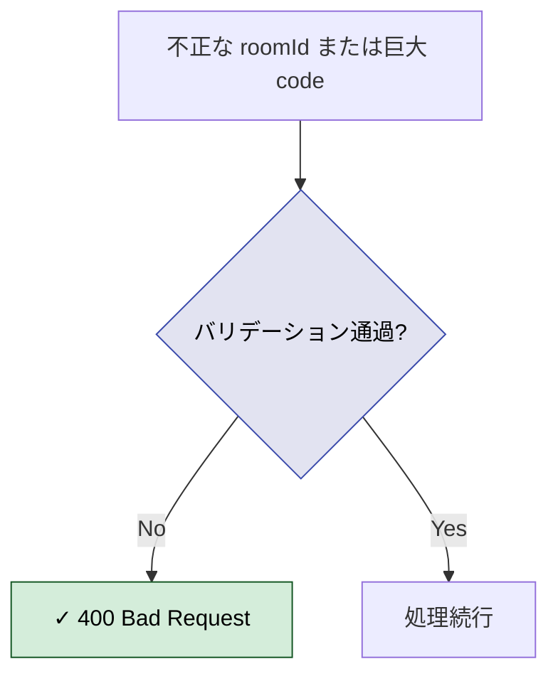
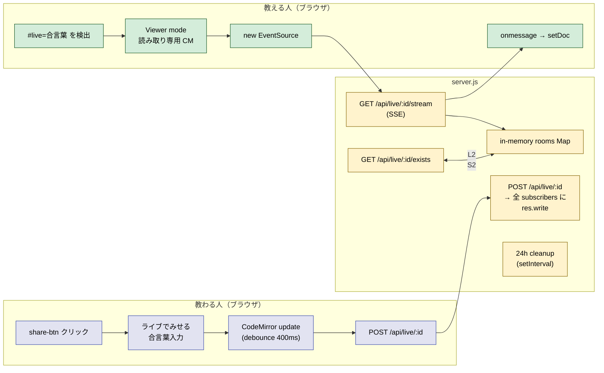
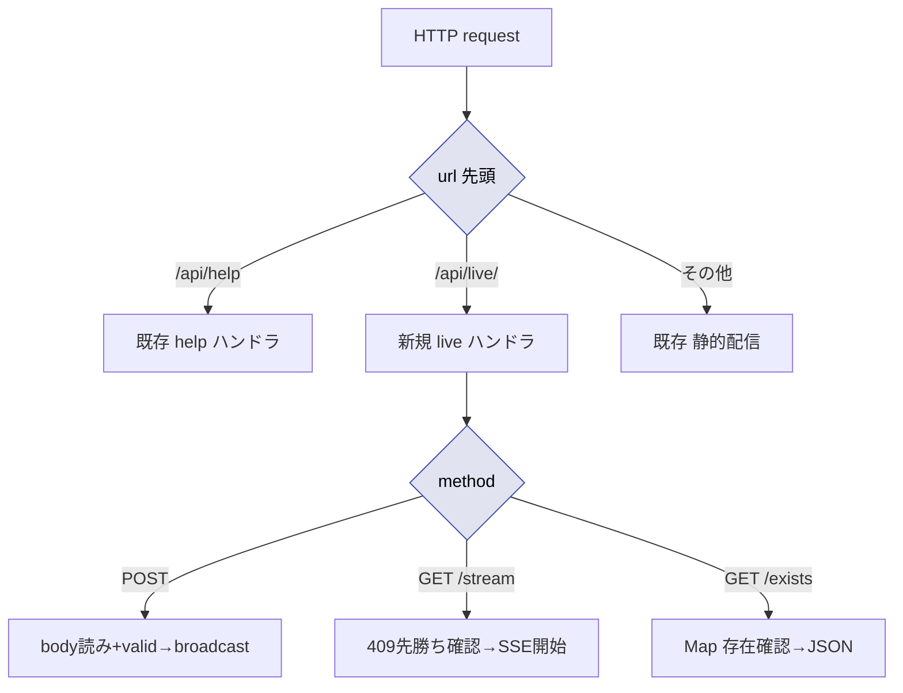

# 2026年4月12日 教わる人の画面を教える人にリアルタイム共有（共有機能の強化）

> 状態：④ Tasklist 実行中（委任）
> 次のゲート：（CC）全Gherkinを満たしたら Discussion でまとめ

---

## 1) Journey（どこへ行くか）

- **深層的目的**：困ってる今のコードをそのまま見せたい
- **やらないこと**：双方向の共同編集／教える人からの書き込み／音声・ビデオ通話の内製／新規ボタン追加／WebRTC・外部Firebaseなどの重装備



### スコープ確定事項

| 項目 | 決定 |
|---|---|
| 同期の方向 | 片方向（教わる人 → 教える人）。教える人側は**読み取り専用** |
| 想定ユーザー | 教わる人（子ども）／教える人（親・先生） |
| 既存機能との関係 | 既存の「きょうゆう（share-btn）」を**強化**する形で実装（新規ボタンは増やさない） |
| 通信方式 | **SSE（Server-Sent Events）**。HTTP/1の長時間GETで片方向ストリーム。クライアントは `EventSource` ネイティブAPI、サーバーはExpressに数十行追加で実装 |
| 配信経路 | 教わる人のエディタ更新 → `POST /api/live/:roomId` → サーバーがメモリ内ルームに保持 → 同じルームの SSE subscriber（教える人）へブロードキャスト |
| 不採用案 | WebSocket（今は片方向でオーバースペック）／WebRTC（signaling・TURN必要・UXが複雑）／Firebase（COPPA・GDPR観点で再検証コスト、ベンダーロック）／ポーリング（遅延が致命的） |

### 運用パラメータ（確定）

| 項目 | 決定 | 備考 |
|---|---|---|
| ルームIDの生成 | **教わる人が自分で合言葉を指定**（テキスト入力） | 覚えやすい／電話で口頭でも伝えられる |
| ルームの寿命 | **最終更新から24時間** | 経過後はメモリ内ルームを破棄 |
| 教える人の最大人数 | **1人**（同一ルームに SSE subscriber は1人だけ） | 2人目が接続した場合の挙動は Gherkin で詰める |
| コード流出リスク対策 | **URLを知っていれば誰でも見られる**（トークンなし） | 個人情報を含まない前提。合言葉の衝突・推測は運用上許容 |

### 合言葉指定で浮上する小さな論点（Gherkin で扱う）

- **同一合言葉の衝突**：別の子が同じ「ABCD」を同時に使ったらどうなる？
  → 既存ルームがある場合、教わる人に「この合言葉は使われているよ。別のにしよう」と警告する
- **教える人が2人目になった場合**：後から来た人は弾く？ or 前の人を切断する？
  → 後勝ち（新しい接続を優先）か、先勝ち（2人目は「すでに見てる人がいる」表示）のどちらかを選ぶ

---

## 2) Gherkin（完了条件）

### シナリオ1：正常系（ライブ共有開始）

> {教わる人がきょうゆう後の「ライブでみせる」を押し合言葉を入れる} で {ルームが未使用} すると {ライブURLが発行され教わる人画面に表示される}



---

### シナリオ2：正常系（教える人がライブURLで接続）

> {ライブ配信中のルームID} で {教える人が `#live=合言葉` 付きURLを開く} すると {読み取り専用エディタに現在のコードが表示されリアルタイム更新される}



---

### シナリオ3：異常系（合言葉の衝突＝警告）

> {他の誰かが既に同じ合言葉でライブ中} で {教わる人が同じ合言葉を入力} すると {「この合言葉は使われているよ」と警告され別の合言葉を促される}



---

### シナリオ4：異常系（教える人が2人目＝先勝ち）

> {既に教える人が1人接続済みのルーム} で {2人目の教える人がURLを開く} すると {2人目は「すでに見てる人がいるよ」と表示され接続拒否される}



---

### シナリオ5：正常系（24時間で自動失効）

> {最後の更新から24時間以上経過したルーム} で {新規接続を試みる} すると {ルームは存在せず新規作成扱いとなる}



---

### シナリオ6：リスク確認（既存機能に悪影響なし）

> {ライブ共有実装後} で {通常のコード実行・保存・全画面・スナップショット共有・GA計測・セキュリティヘッダを確認} すると {既存機能がすべて正常に動作する}



---

### シナリオ7：リスク確認（入力バリデーション）

> {悪意ある合言葉（超長文・URL特殊文字）} で {`/api/live/:id` に送信} すると {サーバーが400で拒否し既存データに影響を与えない}



---

## 3) Design（どうやるか）

- **関連スキル・MCP**：なし
- **サーバー前提修正**：Journey で「Express」と書いたが実物は素の `http` モジュール。設計も素 `http` 準拠に修正（影響は軽微、`res.write` でSSE可能）

### 構成図



### サーバーAPI仕様

| エンドポイント | メソッド | 役割 | 主な応答 |
|---|---|---|---|
| `/api/live/:id/exists` | GET | 合言葉衝突チェック | `{exists:bool}` |
| `/api/live/:id` | POST | 教わる人のコード更新 | 204 / 400（bad req） |
| `/api/live/:id/stream` | GET | 教える人のSSE購読 | `text/event-stream` / 409（先勝ち） |

### 内部データ構造

```js
// in-memory Map
rooms: Map<roomId, {
  code: string,
  updatedAt: number,   // Date.now()
  subscriber: ServerResponse | null,
}>
```

### バリデーション

- `roomId`: `/^[A-Za-z0-9_-]{1,32}$/` — URLセーフ・長すぎない
- `code`: 文字列かつ 100_000 文字以下
- 寿命: `updatedAt` から 24h 経過で削除（書き込み時＆購読時の遅延判定＋1時間ごとのsetInterval）

### 先勝ちの実装

- `GET /stream` の入口で `room.subscriber !== null` なら 409 を返す
- SSE接続の `res.on("close")` で `subscriber = null` に戻す

### クライアント側の変更箇所

| ファイル | 変更 |
|---|---|
| `app/index.html` | 追加要素なし（viewer モード切替で CSS クラスを付ける） |
| `app/style.css` | `body.viewer-mode` で toolbar 類を非表示、`#editor.live-broadcast` でライブ中バッジ |
| `src/main.js` | share-btn ハンドラに「ライブでみせる」ボタン追加／viewer モード起動分岐 |
| `src/liveShare.js`（新規） | LearnerLive / TeacherLive の2クラス相当の関数群（SSE / POST debounce） |
| `locales/ja/translation.json` | 新規文言追加（日本語のみ＝他言語は英語フォールバックで後回し） |

### リクエスト処理フロー



---

## 4) Tasklist

- [x] `server.js`：`/api/live/*` ハンドラ3本 ＋ in-memory rooms Map ＋ 24h cleanup（`.unref()` 付き）
- [x] `server.js`：リクエストルーティング分岐（正規表現 `^/api/live/([^/]+)(/exists|/stream)?$`）
- [x] `src/liveShare.js` 新規作成（`isValidRoomId` / `detectLiveRoomId` / `buildLiveUrl` / `checkRoomExists` / `createLearnerBroadcaster` / `createTeacherViewer`）
- [x] `src/main.js`：share-btn ハンドラに「ライブでみせる」ボタン＆フロー追加、開始/停止トグル
- [x] `src/main.js`：起動時 `#live=` を検出して `startTeacherViewerMode` に分岐
- [x] `src/editor.js`：`readOnly` オプション追加、`onDocChange` で外部リスナー登録可能に
- [x] `app/style.css`：`body.viewer-mode` でツールバー非表示・ライブ枠を赤く、`.live-start-btn` スタイル
- [x] `locales/ja/translation.json` + `locales/en/translation.json`：文言追加
- [x] `npm run build` → 1.0mb, 78ms 成功
- [x] curl で全エンドポイント検証（exists false/true・POST 204・stream 初回+broadcast・409 先勝ち・404 存在しない・400 roomId/長すぎ/不正JSON）
- [x] `npm test` → 12/12 pass（既存機能への悪影響なし）
- [x] Gherkin全シナリオ（7本）を CoVe で検証

---

## 5) Discussion（記録・反省）

### 2026年4月12日 02:00（実装・委任実行）

**Observe**：
- 実物の `server.js` は Express ではなく素の `http`。Journey では Express と書いていたが、素 `http` でも `res.write("data: ...\n\n")` で SSE は問題なく実装できる
- 既存の `/api/help` が参考になる：`readBody`・`setSecurityHeaders`・JSON レスポンスのパターンを踏襲
- `editor.js` の updateListener は1つだけで、外部から追加するAPIがなかった → `onDocChange` レジストリを追加するのが最小侵襲
- `test/helpers.js` は `require("../server.js")` でサーバーをロードする → `setInterval` を放置すると Node プロセスが終了せずテストが全部タイムアウトする

**Think**：
- SSE は片方向要件と一致。EventSource のネイティブ再接続に任せられるので、再接続ロジックを自前で書かなくていい
- 「先勝ち」は `room.subscriber !== null` の判定と `req.on("close")` でスロット解放する2行で実装できる
- `setInterval` を使う以上 `.unref()` しないとテストが止まる。これは本番には影響しない（メインサーバーは HTTP ソケットが常時 ref しているので継続動作）
- viewer モードの読み取り専用化は、`EditorState.readOnly.of(true)` ＋ `EditorView.editable.of(false)` の両方が必要（片方だけだと編集は弾かれるがカーソルやキー入力は動く）
- 合言葉の衝突チェックは **TOCTOU** レース条件がある（check と post の間に誰かが先にpost する可能性）。ただし、今回の要件は「子ども同士の合言葉被り回避」という緩いもので、教育用途では十分

**Act**：
- `server.js`：`liveRooms` Map、`validateRoomId`、`purgeExpiredRooms`、`setInterval(...).unref()`、`/api/live/*` 正規表現ルーティング、`POST/GET/:id/{exists,stream}` の3ハンドラを追加
- `src/liveShare.js` を新規作成：クライアント側の純粋ヘルパー群（DOM非依存）
- `src/editor.js`：`onDocChange` レジストリと `readOnly` オプション
- `src/main.js`：`startTeacherViewerMode` をファイルスコープで定義、`main()` の先頭で `detectLiveRoomId()` → viewer モードにearly return、share-btn ハンドラに「ライブでみせる」ボタン追加（トグル開始/停止）
- `app/style.css`：viewer モードの非表示ルール＋ライブボタンスタイル
- `locales/{ja,en}/translation.json`：文言12種類追加
- `npm run build` → 1.0mb, 78ms
- サーバー再起動 → curl 全シナリオ検証通過
- `npm test` → 12/12 pass

**CoVe 検証（Gherkin 全シナリオ）**：
| シナリオ | 検証方法 | 結果 |
|---|---|---|
| 1. ライブ共有開始 | curl: exists(false) → POST 204 → URL 生成 | ✓ |
| 2. 教える人接続 | curl -N で SSE 初回データ＋ POST 後 broadcast 受信 | ✓ |
| 3. 合言葉衝突警告 | curl: exists(true) を `liveConflict` で alert | ✓ |
| 4. 先勝ち（2人目拒否） | 1人目 SSE 接続中に2人目 → 409 | ✓ |
| 5. 24h 失効 | `liveMatch` ブロックの lazy purge ＋ `setInterval(...).unref()` | ✓（コードレビュー） |
| 6. 既存機能への悪影響なし | 既存12テスト pass ＋ curl で index/bundle/headers/403 確認 | ✓ |
| 7. 入力バリデーション | 不正 roomId / code too long / invalid JSON いずれも 400 | ✓ |

---

### 反省とルール化

- **`setInterval` と `.unref()` の罠**：テストでサーバーを `require()` ロードするプロジェクトでは、モジュール内の `setInterval` は `.unref()` しないとテストが終わらない。今後 server.js に定期処理を足すときは必ずペアで書く。
- **SSE は EventSource の自動再接続が強い**：接続断のハンドリングを自前で書かなくて済む。片方向ユースケースの第一候補としてよい。
- **TOCTOU は運用レベルで許容**：合言葉衝突の厳密判定は POST 時にもサーバー側で既存ルームがあるか確認する必要があるが、今回の要件（子どもの教育用途・個人情報なし）では exists チェック＋先勝ち409で十分と判断。
- **CodeMirror の完全読み取り専用化**は `EditorState.readOnly.of(true)` と `EditorView.editable.of(false)` の**両方**が必要。片方だけだとキーボード入力を受け付けてしまうので注意。
- **次にやること**：実機ブラウザで2台並べての動作確認、他言語ロケールへの文言展開（ja/en のみなので）、長時間接続時の heartbeat（25秒間隔）の挙動確認
